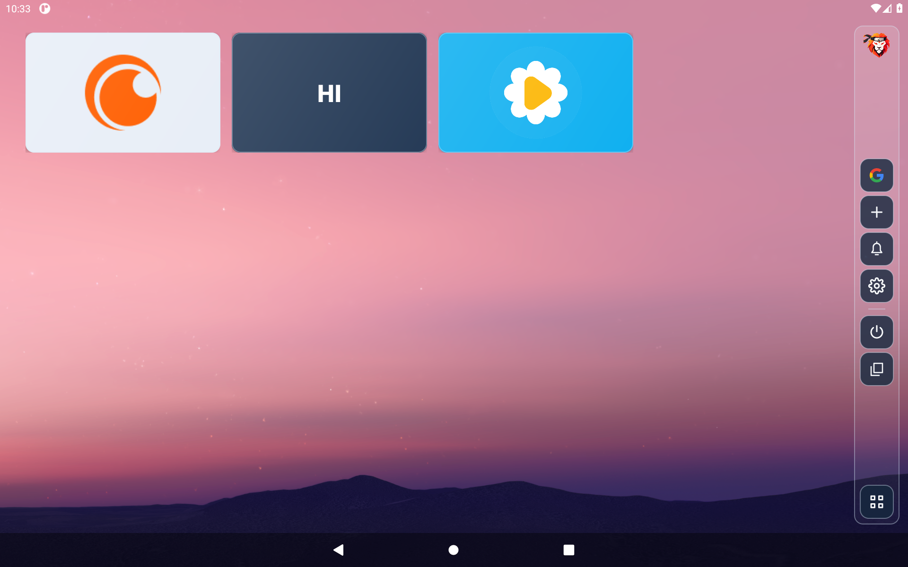
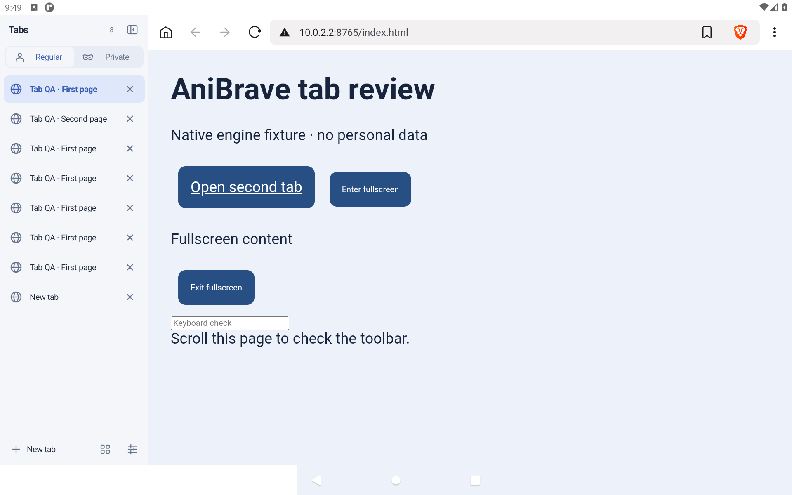

# AniProject

AniProject contains **AniHome**, an Android home-screen launcher, and **AniBrave**, a Brave-based Android browser customization. Contributor and AI guidance is technical-only: see [CONTRIBUTING.md](CONTRIBUTING.md).

## Downloads

| Product | Download | Requirements |
| --- | --- | --- |
| AniHome 0.8.22 | [Download launcher](https://github.com/akasumitlamba/AniProject/releases/download/aniproject-2026.10.22/AniHome-Launcher-0.8.22-release.apk) | Android 8+ |
| AniBrave 0.1.6 | [Download browser](https://github.com/akasumitlamba/AniProject/releases/download/aniproject-2026.10.22/AniBrave-0.1.6-arm64-v8a.apk) | Android 10+, ARM64 |
| AniBrave desktop 0.1.4 | [Download extension](https://github.com/akasumitlamba/AniProject/releases/download/aniproject-2026.10.22/AniBrave-Extension-0.1.4.zip) | Brave desktop |

[Download all three applications together](https://github.com/akasumitlamba/AniProject/releases/download/aniproject-2026.10.22/AniProject-2026.10.21-All-Apps.zip), or use the individual downloads above.

For updates, install the matching signed APK over the existing app. Keep the same signing identity; do not uninstall or clear app data.

## AniHome



[AniHome](launcher/README.md) combines apps and websites on the system wallpaper, with custom banner artwork, widgets, a searchable adaptive app drawer, recent files, configurable gestures and an inline notification/quick-settings sidebar. Wi-Fi and Bluetooth sections support scrolling lists and direct operations through optional Shizuku access. Rotation toggles Auto and Fixed, locking the current display angle. Gesture-driven panels use short directional animations. Notification counts use contrasting corner tags.

The [Banner Store](banners/README.md) includes 159 named banners. It works offline and refreshes anonymously from this public repository. No GitHub account or token is needed. Apps retain local settings, tiles and connection recency; notifications are not uploaded.

```sh
cd launcher
./gradlew :app:testDebugUnitTest :app:lintRelease :app:assembleDebug
```

## AniBrave



[AniBrave](anibrave/README.md) combines the official Brave 1.97.59 ARM64 engine with Java/JavaScript controls for saved playback speed, site viewing modes, immersive website shortcuts, vertical tabs, buffer-ahead preferences and local watch history. Anime reminders and watch logs stay on-device. Browser tabs and immersive shortcuts share the browser profile.

This is an experimental APK customization, not a complete Chromium source build or an official Brave product. Protected streaming and device-specific radio/biometric behavior require hardware validation. Screenshots above use emulator fixtures and are labeled by capture version in [screenshot notes](docs/screenshots/README.md).

## Source layout

- `launcher/`: native Android HOME app, package `app.anihome.launcher`.
- `anibrave/`: browser customization and packaging, package `app.anibrave.main`.
- `banners/`: artwork, catalog, public source references and contribution guide.
- `.github/workflows/`: launcher, browser and source privacy checks.
- `tools/`: tracked-source privacy guard.

## Privacy and licensing

This public repository contains source and technical documentation. Signing keys, credentials, private conversations, device backups and personal captures are excluded. Build signing uses private local configuration. See [contribution guidelines](CONTRIBUTING.md).

Customization sources are MPL-2.0. Upstream notices and licenses remain intact. Third-party trademarks belong to their respective owners; AniProject is independent of Brave Software and the services represented in its banner catalog.
