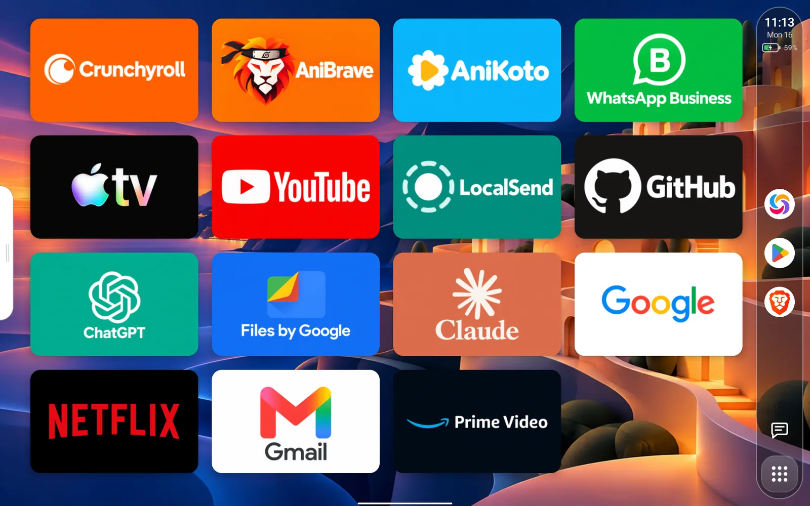
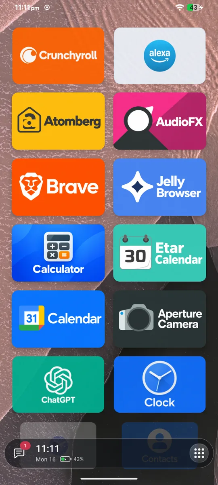
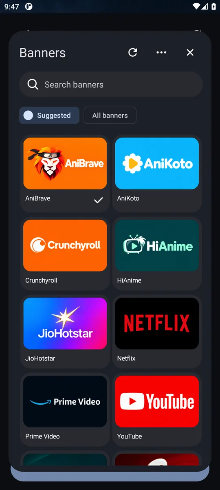
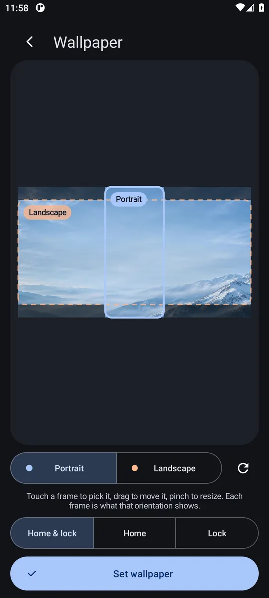
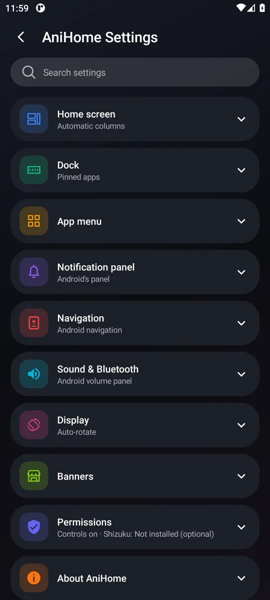
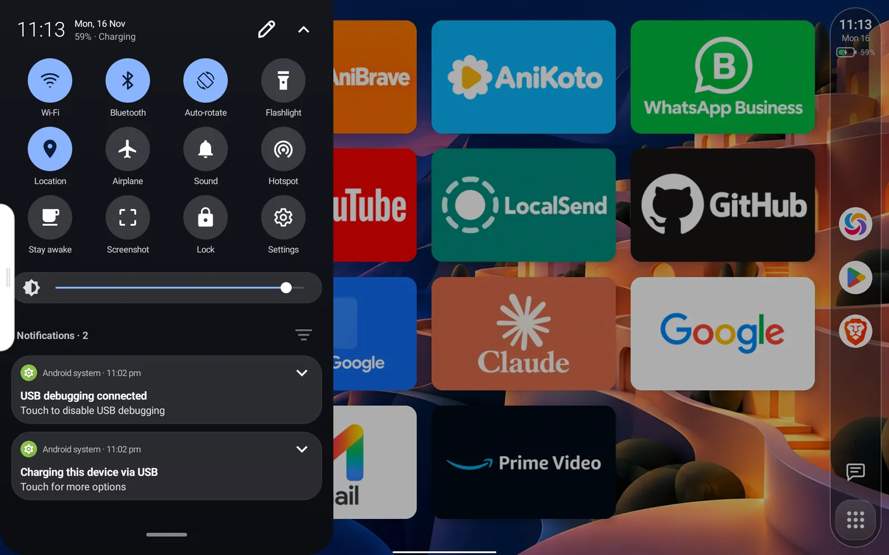
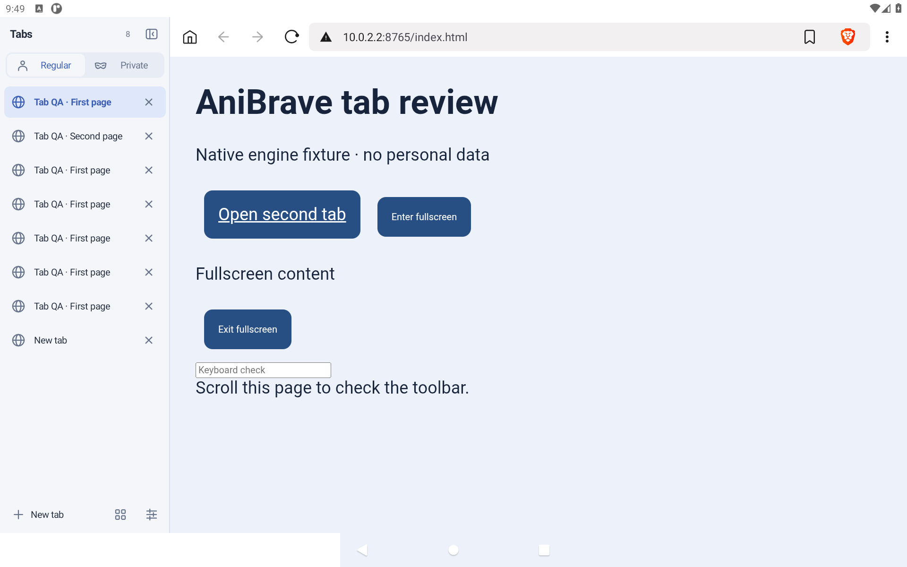

<div align="center">

# AniProject

**A home screen and a browser built for watching.**<br>
AniHome turns your Android tablet or phone into a clean wall of banners. AniBrave is a Brave-based browser with playback controls and episode memory.

[](https://github.com/akasumitlamba/AniProject/releases/latest)
[](#install)
[](LICENSE)

[**Download AniHome**](https://github.com/akasumitlamba/AniProject/releases/latest/download/AniHome-Launcher-1.1.0-release.apk) &nbsp;·&nbsp;
[**Download AniBrave**](https://github.com/akasumitlamba/AniProject/releases/latest/download/AniBrave-1.1.0-arm64-v8a.apk) &nbsp;·&nbsp;
[Release notes](docs/releases/1.1.0.md) &nbsp;·&nbsp;
[All releases](https://github.com/akasumitlamba/AniProject/releases)

<br>



</div>

<br>

## What's inside

| | Product | What it is | Runs on |
| :-: | --- | --- | --- |
| 🏠 | **[AniHome](launcher/README.md)** | Home screen launcher: banners, widgets, a Control Center panel, gestures and wallpapers | Android 8+ (phone and tablet) |
| 🦁 | **[AniBrave](anibrave/README.md)** | Brave-based browser with playback speed, site views, vertical tabs and episode memory | Android 10+, ARM64 |
| 🧩 | **[AniBrave for desktop](extensions/anibrave/README.md)** | Brave desktop extension with the same playback and episode memory | Brave on PC |

<br>

## AniHome

<table>
<tr>
<td width="25%"></td>
<td width="25%"></td>
<td width="25%"></td>
<td width="25%"></td>
</tr>
<tr>
<td align="center"><sub>Home on a phone</sub></td>
<td align="center"><sub>Banner store</sub></td>
<td align="center"><sub>Wallpaper framing</sub></td>
<td align="center"><sub>AniHome Settings</sub></td>
</tr>
</table>

**Home screen**
- Apps, websites and widgets share one grid. Every app gets a **banner** from the online store, or keep plain icons: you choose per app, and choose the default in Settings.
- Hold to see an item's options, hold and move to rearrange. Banners grow and fade in as you scroll a long Home screen.
- Banners come from the [banner store](banners/README.md) (500+ apps and websites) and stay on your device once applied. Refresh one to the latest whenever you like.

**Wallpapers**
- AniHome's own [wallpaper collections](banners/wallpapers/README.md) by category, plus your gallery or any wallpaper app.
- Frame the picture at your screen's exact shape, with a **portrait** and a **landscape** frame on the same image.

**Dock**
- Clock, date and battery, your pinned or recent apps centred on the dock, and the app menu.
- Show or hide each part, or add a **message of your own** that slides through like an LED board when it's long.

**App menu**
- Search apps, files and the web. Recent apps on top. Show apps as a **grid or a list**.

<br>



**Notification panel and Control Center**
- Swipe down for notifications and 20 one-tap controls: Wi-Fi, Bluetooth, rotation, flashlight, night light, hotspot, stay awake and more, plus your apps' own quick actions.
- Brightness, volume and a now-playing card. Swipe down to expand the controls, up to fold them, up again to close.
- Blurred glass or solid, side panel or full screen. Prefer Android's own? Turn AniHome's panel off and Android's shade and status bar are back.

**Gestures, sound and more**
- Swipe gestures on Home, double-tap to lock, and on supported tablets AniHome's own gesture navigation.
- AniHome's volume panel with a slider for each app playing sound, Bluetooth and Wi-Fi lists with quick actions, and a weather widget.

<br>

## AniBrave



- The official **Brave 1.99.57** engine (Chromium 157) with AniBrave's own controls on top.
- **Playback speed** remembered per site, **desktop or mobile** site views, a streaming buffer and **vertical tabs**.
- **Episode memory**: it remembers where you stopped and offers to continue, even on another site. History stays on your device.
- **Fullscreen website shortcuts**: pin a site to Home and it opens like an app, without the address bar.
- A built-in **new-tab page** with a clock, search with your default engine, and the weather.

AniBrave is an independent customization of Brave, not an official Brave product.

<br>

## AniBrave for desktop

The same playback speed, site views and episode memory for **Brave on your PC**.

1. Download this repository (**Code → Download ZIP**) and unzip it to a folder you'll keep.
2. Open `brave://extensions`, turn on **Developer mode**, choose **Load unpacked** and pick the `extensions/anibrave` folder.
3. Pin **AniBrave** from the extensions menu, then reload open sites.

Full guide: [extensions/anibrave](extensions/anibrave/README.md).

<br>

## Install

1. Download **AniHome** and, if you want the browser, **AniBrave** from the [latest release](https://github.com/akasumitlamba/AniProject/releases/latest).
2. Open the APKs on your device and allow installs from your browser or file manager when Android asks.
3. Open AniHome. A short setup asks for the two things it needs: to be your **home app**, and **notification access** for the panel.

**Updating:** install the new APK over the old one. Your layout, banners, settings and history are kept. AniHome can also update itself from **Settings → About**. Each release lists SHA-256 checksums.

<details>
<summary><b>Permissions, and why</b></summary>

<br>

AniHome asks for anything else only when you use the feature that needs it.

| Permission | Used for |
| --- | --- |
| Home app | Pressing Home opens AniHome |
| Notification access | Showing your notifications in AniHome's panel. They never leave the device |
| AniHome controls (Accessibility) | Screen off, recent apps, stay awake, the swipe-down panel in every app and the volume panel. It never reads your screen |
| Photos and media | Recent files in the app menu |
| Location and Bluetooth | Listing Wi-Fi networks and Bluetooth devices in the panel |
| Modify system settings | Brightness and rotation controls |
| [Shizuku](https://shizuku.rikka.app/) (optional) | One-tap system toggles, per-app volume, two Bluetooth audio devices and Wi-Fi extras, without root |

</details>

<br>

## Privacy

- No accounts, ads or analytics. Your layout, notifications and watch history stay on your device.
- Banners and wallpapers are downloaded anonymously from this repository. Weather sends only the city you chose to [Open-Meteo](https://open-meteo.com/).

<br>

## Contribute banners and wallpapers

Banners and wallpapers live in this repository and reach every AniHome without an app update:

- **Banners**: see the [banner guide](banners/README.md) and [contributing notes](banners/CONTRIBUTING.md).
- **Wallpapers**: add a folder (a category) or images under [`banners/wallpapers`](banners/wallpapers/README.md); they appear in the app's wallpaper picker on its next open.

<br>

## Build from source

<details>
<summary><b>AniHome</b></summary>

```sh
cd launcher
./gradlew :app:testDebugUnitTest :app:lintRelease :app:assembleDebug
```

Requires JDK 17 and the Android SDK. Release builds use your own signing configuration.
</details>

<details>
<summary><b>AniBrave</b></summary>

AniBrave patches the official Brave ARM64 APK with its own features. See [anibrave/README.md](anibrave/README.md) for the tools, tests and signing.
</details>

| Folder | Contents |
| --- | --- |
| [`launcher/`](launcher) | AniHome, package `app.anihome.launcher` |
| [`anibrave/`](anibrave) | AniBrave, package `app.anibrave.main` |
| [`extensions/anibrave/`](extensions/anibrave) | Desktop extension |
| [`banners/`](banners) | Banner catalog, artwork and wallpapers |
| [`docs/releases/`](docs/releases) | Release notes |

See [CONTRIBUTING.md](CONTRIBUTING.md), the [changelog](CHANGELOG.md) and the [release policy](RELEASING.md).

<br>

## License

AniProject's source is licensed under the [Mozilla Public License 2.0](LICENSE). Brave and Chromium keep their own licenses and notices. App names and logos in the banner catalog belong to their owners; AniProject is independent of Brave Software and of the services shown.

<div align="center">
<br>
<sub>Made by <a href="https://github.com/akasumitlamba">akasumitlamba</a></sub>
</div>
